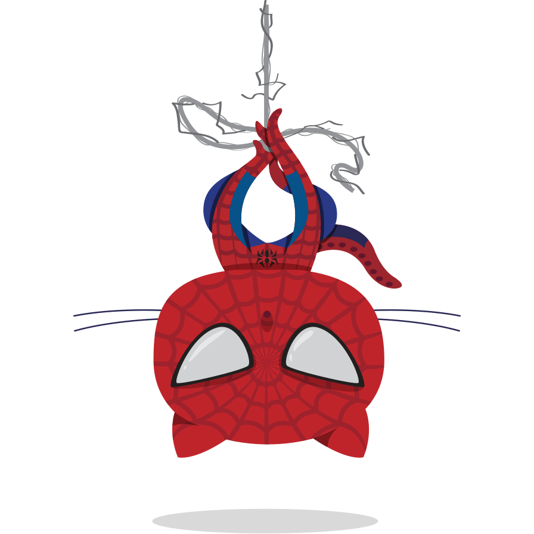

## Hi there Peeps👋

  

  

### 📅 GitHub Contribution Calendar

### 🔥 Most Used Languages

### 📊 Most Used (with Details)

### 🕒 Recently Used

### 📌 Indepth Analysis

### 🧠 Mildly Interesting Habits

### 🧑‍💻 Peek on my Leetcode 

### 📝 Code Snippet of the Day

## ♟️ Chess Stats

<!--START_SECTION:chessStats-->
<!-- Automatically generated with https://github.com/Balastrong/chess-stats-action -->

| Type | Rapid ⏲️ | Blitz ⚡ | Bullet 🔫 |
|:---:|:---:|:---:|:---:|
| Current | 1365 | 1086 | 955 |
| Best | 1431 | 1382 | 971 |

| White ⚪ | Black ⚫ | Result 🏆 | Date 📅 | Position 🗺️ | Type 🕕 |
|:---:|:---:|:---:|:---:|:---:|:---:|
| **vijay_kg** | bhooshanar | resigned ❌ | 7/11/2026 | <a href="http://www.ee.unb.ca/cgi-bin/tervo/fen.pl?select=r2q1rk1/ppp1pp1p/3p1npb/8/1n1PP1b1/2N2N2/PPPQBPPP/R3K2R w KQ - 0 10">Link</a> | Blitz |
| deventio7 | **vijay_kg** | timeout ❌ | 6/11/2026 | <a href="http://www.ee.unb.ca/cgi-bin/tervo/fen.pl?select=6r1/pp1k1p2/4p3/3pBP2/7p/8/PPP5/6RK b - - 0 33">Link</a> | Blitz |
| shahinmohd | **vijay_kg** | win 🥇 | 6/11/2026 | <a href="http://www.ee.unb.ca/cgi-bin/tervo/fen.pl?select=R7/p4kpp/1p6/8/8/1P3nP1/7r/7K w - - 0 34">Link</a> | Blitz |
| **vijay_kg** | VynceSidviel | timeout ❌ | 6/11/2026 | <a href="http://www.ee.unb.ca/cgi-bin/tervo/fen.pl?select=3r3k/p5p1/5p1p/8/Q7/1B1q2PP/P5RK/8 w - - 0 41">Link</a> | Blitz |
| **vijay_kg** | Babiolles | win 🥇 | 6/11/2026 | <a href="http://www.ee.unb.ca/cgi-bin/tervo/fen.pl?select=rnb1kb1r/pp3ppp/2q2n2/1Bp5/3P4/2N2N2/PP3PPP/R1BQK2R b KQkq - 3 8">Link</a> | Blitz |
| **vijay_kg** | pacokosacha | checkmated ❌ | 20/10/2026 | <a href="http://www.ee.unb.ca/cgi-bin/tervo/fen.pl?select=3R4/p1p5/2p3pk/7n/6KR/2P1r3/PP4rP/8 w - - 4 37">Link</a> | Blitz |
| ChesterCheckers1 | **vijay_kg** | insufficient ⏸️ | 19/10/2026 | <a href="http://www.ee.unb.ca/cgi-bin/tervo/fen.pl?select=8/8/8/8/8/4k3/6K1/8 b - - 0 80">Link</a> | Blitz |
| Foubri | **vijay_kg** | resigned ❌ | 10/10/2026 | <a href="http://www.ee.unb.ca/cgi-bin/tervo/fen.pl?select=8/5kPK/8/8/8/8/8/8 b - - 2 64">Link</a> | Blitz |
| **vijay_kg** | Thisisnotcheckers2 | insufficient ⏸️ | 6/10/2026 | <a href="http://www.ee.unb.ca/cgi-bin/tervo/fen.pl?select=8/7K/8/8/8/8/8/1k6 b - - 0 67">Link</a> | Blitz |
| Sinwar-23 | **vijay_kg** | resigned ❌ | 6/10/2026 | <a href="http://www.ee.unb.ca/cgi-bin/tervo/fen.pl?select=4r1k1/p4pp1/b1R1q2p/3pNn2/1P1P4/P3P1P1/3Q1PBP/6K1 b - - 0 26">Link</a> | Blitz |

<!--END_SECTION:chessStats-->
